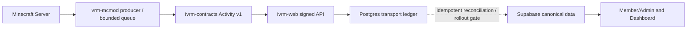

# Minecraft Activity 移管時のデータ/責務対応表

Reviewed: 2026-10-26. Status: legacy reference + target boundary, **not production cutover evidence**.

## Legacy scope (preserve historical code/docs)

| Legacy artifact | Original responsibility | New ownership / verification |
|---|---|---|
| `mods/fabric` | Fabric 1.20.1 event capture/queue | Server-side cross-version integration: [ivrm-mcmod](https://github.com/ivRooom/ivrm-mcmod), actual server loader/config is separately confirmed |
| `apps/api` | Activity API and auth/event ingestion | [ivrm-web apps/api](https://github.com/ivRooom/ivrm-web/tree/main/apps/api) |
| `packages/shared-types` | Historical API/Mod types | [ivrm-contracts](https://github.com/ivRooom/ivrm-contracts) versioned Activity Event v1 / portable bundle |
| `apps/api/drizzle/migrations` | Historical Activity DB schema | API transport ledger (Postgres) vs canonical domain data (Supabase/ivrm-core) separated; **no direct DB migration inferred** |
| `packages/reward-engine` / `ranking-engine` | Reward and leaderboard logic | Canonical API processing/reconciliation; exact migrated behavior requires tests |
| `integrations/lunaria` | Old Discord rank posting interface | Legacy Lunaria is Archived. Current Discord integration owner Herta; compatibility requires contract review |

## Target logical data flow

Canonical contract: [Activity v1](https://github.com/ivRooom/ivrm-contracts/blob/main/docs/MINECRAFT-ACTIVITY-V1.md). [Contract PR #6](https://github.com/ivRooom/ivrm-contracts/pull/6), [Consumer PR #303](https://github.com/ivRooom/ivrm-web/pull/303), [Producer PR #6](https://github.com/ivRooom/ivrm-mcmod/pull/6) are all **merged** as confirmed 2026-10-26. Merge alone does not establish full production activation or transferred historical records.

## Forbidden assumptions

- This Repository's `docs/requirements.md` goals, random reward distribution, timing/AFK constants or Fabric stack are **not** automatically requirements approved for the new Main/Resource runtime.
- Do not run old `apps/api` migrations, `/ivrm admin flush` or secret-rotation commands against the new runtime without an implementation-specific runbook.
- Do not migrate historical `Drizzle` tables to the API transport ledger and treat it as canonical. Canonical Activity/Rewards/Ranking/Identity data ownership must be respected.
- Do not report QA complete without producer/consumer contract+signed retry/replay/out-of-order tests, data reconciliation and runtime receipt evidence.

## Exit criteria to archive this migration source

1. Historical business rules mapped and independently testable in new owner code.
2. Producer/contract/consumer pin compatibility verified at exact SHAs.
3. Existing data reconciliation/backfill/identity migration, if required, explicitly approved and validated.
4. Operations Runbook, rollback and production data retention/restore accepted.
5. Archive decision recorded with the owner; until then keep Repository as **maintenance**.
